# Organiza+

## Aplicación móvil para la organización y administración de tareas

Organiza+ es una aplicación móvil desarrollada con React Native, Expo y TypeScript, que permite administrar tareas personales desde un dispositivo móvil.

La aplicación incorpora funcionalidades para crear, visualizar, modificar y eliminar tareas, además de utilizar periféricos internos del dispositivo, como la cámara y el GPS. De esta manera, es posible adjuntar fotografías y registrar la ubicación geográfica asociada a una tarea.

El proyecto también contempla almacenamiento local, funcionamiento sin conexión a internet y sincronización de información con un servidor remoto desarrollado con Laravel.

## 1. Objetivo del proyecto

### 1.1. Objetivo general

Desarrollar una aplicación móvil que facilite la organización de tareas personales mediante herramientas de gestión, almacenamiento de información e integración con los periféricos internos del dispositivo.

### 1.2. Objetivos específicos

- Implementar operaciones para crear, consultar, editar y eliminar tareas.
- Integrar la cámara del dispositivo para capturar fotografías y asociarlas a las tareas.
- Utilizar el GPS para obtener y registrar la ubicación geográfica.
- Solicitar los permisos necesarios para acceder a los periféricos del dispositivo.
- Incorporar almacenamiento local para conservar la información.
- Permitir el uso de la aplicación cuando no existe conexión a internet.
- Implementar la sincronización de las tareas pendientes con un servidor remoto.
- Aplicar pruebas para comprobar el funcionamiento de las principales funcionalidades.

## 2. Tecnologías y herramientas utilizadas

| Tecnología o herramienta | Uso en el proyecto                                    |
| ------------------------ | ----------------------------------------------------- |
| React Native             | Desarrollo de la interfaz móvil.                      |
| Expo                     | Configuración y ejecución de la aplicación.           |
| Expo Router              | Organización de las pantallas y navegación.           |
| TypeScript               | Desarrollo y definición de tipos de datos.            |
| Expo Camera              | Acceso a la cámara del dispositivo.                   |
| Expo Location            | Obtención de la ubicación mediante GPS.               |
| AsyncStorage             | Almacenamiento local de información.                  |
| SecureStore              | Almacenamiento seguro de información de sesión.       |
| NetInfo                  | Detección del estado de conexión a internet.          |
| Laravel                  | Desarrollo del servidor y la API REST.                |
| Laravel Sanctum          | Autenticación mediante tokens.                        |
| MySQL                    | Almacenamiento de información en el servidor.         |
| Jest                     | Ejecución de pruebas automatizadas.                   |
| Postman                  | Comprobación de las solicitudes a la API.             |
| Git y GitHub             | Control de versiones y publicación del código fuente. |
| Visual Studio Code       | Editor utilizado durante el desarrollo.               |

## 3. Funcionalidades principales

Organiza+ incorpora las siguientes funcionalidades:

- Registro e inicio de sesión de usuarios.
- Visualización de las tareas registradas.
- Creación de nuevas tareas.
- Edición de la información de una tarea.
- Eliminación de tareas.
- Cambio del estado de las tareas.
- Captura de fotografías mediante la cámara del dispositivo.
- Registro de coordenadas geográficas mediante el GPS.
- Almacenamiento local de información.
- Funcionamiento sin conexión a internet.
- Sincronización de tareas pendientes con el servidor.
- Cierre de sesión.

## 4. Integración con los periféricos del dispositivo

Una de las características principales de Organiza+ es la utilización de recursos internos del dispositivo móvil.

### 4.1. Cámara

La aplicación utiliza Expo Camera para acceder a la cámara del dispositivo.

Al crear una tarea, el usuario puede tomar una fotografía y asociarla a la actividad. Esta funcionalidad permite complementar la información escrita con un registro visual.

La fotografía queda asociada a la tarea y puede almacenarse localmente para su posterior sincronización con el servidor.

### 4.2. GPS y ubicación geográfica

La aplicación utiliza Expo Location para obtener la ubicación geográfica del dispositivo.

Al crear una tarea, se puede registrar la latitud y longitud correspondientes a la ubicación obtenida. Estos datos quedan asociados a la tarea y permiten identificar el lugar donde fue registrada.

### 4.3. Solicitud de permisos

Para utilizar estos recursos, la aplicación solicita los permisos correspondientes al usuario.

Los permisos configurados son:

- **Cámara:** permite fotografiar las tareas.
- **Ubicación mientras se usa la aplicación:** permite obtener la ubicación al crear una tarea.

La configuración de estos permisos se encuentra en `app.json`.

## 5. Almacenamiento y funcionamiento sin conexión

Organiza+ incorpora almacenamiento local mediante AsyncStorage, lo que permite conservar información en el dispositivo.

Además, utiliza NetInfo para detectar si existe conexión a internet.

Cuando el dispositivo se encuentra sin conexión, la aplicación permite trabajar con las tareas utilizando los mecanismos de almacenamiento local y sincronización implementados.

Cuando se recupera la conexión, las tareas pendientes pueden enviarse al servidor Laravel. Este proceso permite mantener la información local y remota sincronizada.

La aplicación también contempla mecanismos para evitar que una misma tarea pendiente se registre repetidamente durante la sincronización.

## 6. Servidor y API REST

El proyecto incorpora un backend desarrollado con Laravel, que proporciona una API REST para gestionar la información de los usuarios y sus tareas.

La API contempla las siguientes operaciones:

| Método    | Endpoint          | Función                           |
| --------- | ----------------- | --------------------------------- |
| POST      | `/api/register`   | Registrar un usuario.             |
| POST      | `/api/login`      | Iniciar sesión.                   |
| GET       | `/api/me`         | Consultar el usuario autenticado. |
| POST      | `/api/logout`     | Cerrar sesión.                    |
| GET       | `/api/tasks`      | Consultar tareas.                 |
| POST      | `/api/tasks`      | Crear una tarea.                  |
| GET       | `/api/tasks/{id}` | Consultar una tarea específica.   |
| PUT/PATCH | `/api/tasks/{id}` | Modificar una tarea.              |
| DELETE    | `/api/tasks/{id}` | Eliminar una tarea.               |

Las rutas que requieren autenticación están protegidas mediante Laravel Sanctum. Para acceder a ellas, la aplicación debe enviar un token válido.

La información de las tareas puede incluir título, descripción, estado, imagen y coordenadas geográficas.

## 7. Estructura del proyecto

La estructura general del repositorio es la siguiente:

```text
OrganizaPlus/
├── assets/
├── backend/
│   ├── app/
│   ├── bootstrap/
│   ├── config/
│   ├── database/
│   ├── public/
│   ├── resources/
│   ├── routes/
│   ├── storage/
│   ├── tests/
│   ├── composer.json
│   └── .env.example
├── docs/
│   ├── evidencias/
│   └── base-de-datos/
│       └── organiza_plus.sql
├── scripts/
├── src/
│   ├── app/
│   ├── components/
│   └── services/
├── app.json
├── package.json
├── package-lock.json
├── tsconfig.json
└── README.md
```

### 7.1. Descripción de las carpetas principales

- `src/app/`: contiene las pantallas principales de la aplicación.
- `src/components/`: contiene componentes reutilizables de la interfaz.
- `src/services/`: contiene servicios relacionados con la comunicación y gestión de información.
- `assets/`: almacena recursos gráficos utilizados por la aplicación.
- `backend/`: contiene el servidor Laravel y la API REST.
- `backend/routes/api.php`: define las rutas de la API.
- `backend/database/`: contiene las migraciones y otros elementos relacionados con la base de datos.
- `docs/evidencias/`: almacena las capturas utilizadas para documentar el funcionamiento del proyecto.
- `docs/base-de-datos/`: contiene el respaldo SQL para recuperar la estructura y los datos de ejemplo de la base de datos.

## 8. Instalación y ejecución

### 8.1. Requisitos

Para ejecutar el proyecto se requiere:

- Node.js y npm.
- PHP 8.3 o compatible con la versión de Laravel utilizada.
- Composer.
- MySQL.
- Laragon u otro entorno que permita ejecutar PHP y MySQL.
- Expo Go instalado en el dispositivo móvil.
- Visual Studio Code u otro editor de código.

### 8.2. Configuración del backend

Primero, ingresar a la carpeta del backend:

```powershell
cd backend
```

Instalar las dependencias:

```powershell
composer install
```

Crear el archivo de configuración local a partir del ejemplo:

```powershell
Copy-Item .env.example .env
```

Generar la clave de Laravel:

```powershell
php artisan key:generate
```

Crear previamente una base de datos MySQL llamada `organiza_plus` y configurar las credenciales correspondientes en el archivo `.env`.

**Importar el respaldo de la base de datos:**

El proyecto incluye un respaldo SQL en `docs/base-de-datos/organiza_plus.sql`, que contiene la estructura de las tablas y los registros de usuarios y tareas de ejemplo.

Para restaurarlo utilizando HeidiSQL:

1. Abrir HeidiSQL y conectarse al servidor MySQL local.
2. Abrir el archivo `docs/base-de-datos/organiza_plus.sql`.
3. Ejecutar el archivo SQL para crear las tablas y recuperar los registros.

Después de importar el respaldo, ejecutar las migraciones para aplicar cualquier cambio pendiente:

```powershell
php artisan migrate
```

Iniciar el servidor:

```powershell
php artisan serve --host=0.0.0.0 --port=8000
```

### 8.3. Configuración del frontend

Desde la carpeta principal del proyecto, instalar las dependencias:

```powershell
npm install
```

Configurar la dirección de la API en:

`src/services/api.ts`

La dirección debe utilizar la IP local del computador donde se ejecuta Laravel, por ejemplo:

```typescript
export const API_URL = "http://IP_LOCAL_DEL_COMPUTADOR:8000/api";
```

Se debe reemplazar `IP_LOCAL_DEL_COMPUTADOR` por la dirección IP correspondiente. El dispositivo móvil y el computador deben estar conectados a la misma red para realizar las pruebas mediante la red local.

Iniciar Expo:

```powershell
npx expo start --go --lan
```

Finalmente, abrir Expo Go en el dispositivo móvil y escanear el código QR que muestra la terminal.

## 9. Pruebas realizadas

Durante el desarrollo se realizaron pruebas funcionales y automatizadas para comprobar el comportamiento de la aplicación.

Entre las verificaciones realizadas se encuentran:

- Creación, edición y eliminación de tareas.
- Captura de fotografías mediante la cámara.
- Obtención y registro de coordenadas geográficas.
- Conservación de información en el almacenamiento local.
- Funcionamiento sin conexión a internet.
- Sincronización de tareas pendientes con Laravel.
- Validación de acceso a rutas protegidas mediante autenticación.
- Comprobación de respuestas de la API utilizando Postman.

### 9.1. Pruebas automatizadas

Se ejecutaron pruebas con Jest para comprobar diferentes partes de la aplicación.

**Resultado registrado:**

- 3 suites de pruebas aprobadas.
- 9 pruebas aprobadas.
- 0 pruebas fallidas.

Los archivos de pruebas corresponden a los servicios de tareas y ubicación, además del componente relacionado con la cámara.

Para ejecutar las pruebas:

```powershell
npm test
```

También se realizó una comprobación de tipos con:

```powershell
npx tsc --noEmit
```

## 10. Evidencias del proyecto

Las siguientes evidencias documentan las principales funcionalidades implementadas en Organiza+ y las pruebas realizadas durante el desarrollo.

### Evidencia 01. Pantalla principal

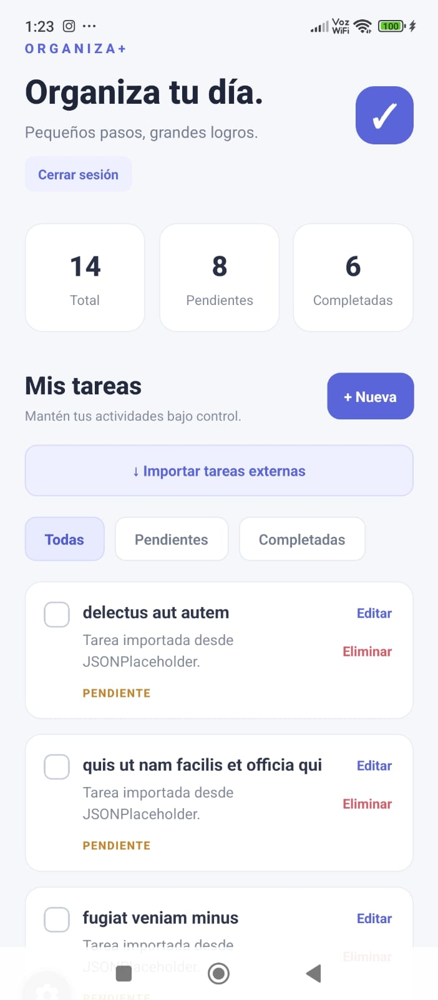

### Evidencia 02. Registro e inicio de sesión

**Inicio de sesión**

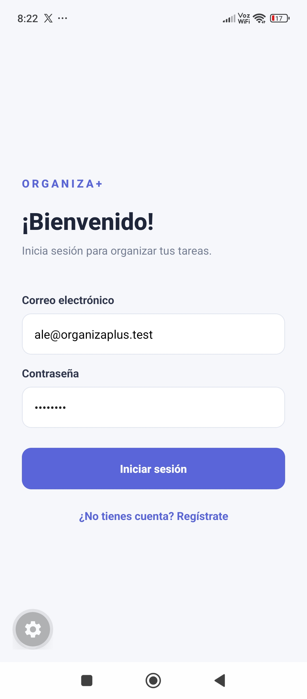

**Registro de usuario**

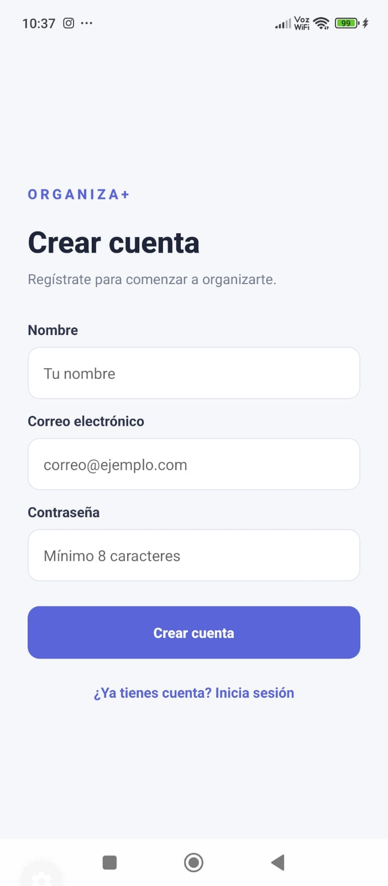

### Evidencia 03. Cierre de sesión

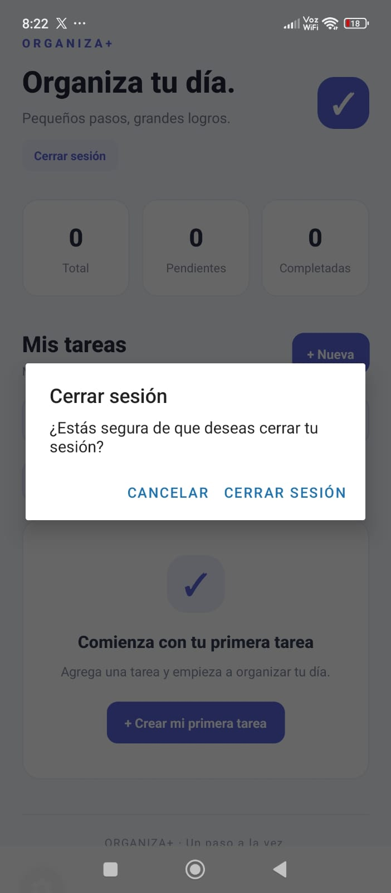

### Evidencia 04. Permisos de cámara y GPS

**Permiso de cámara**

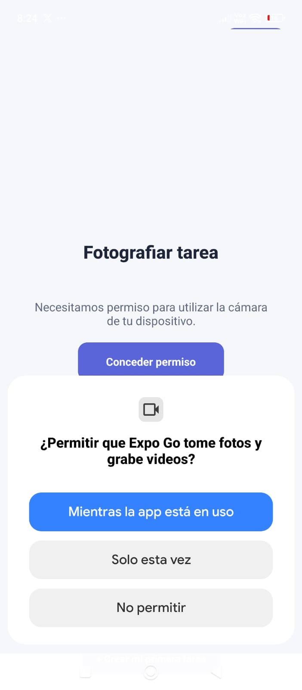

**Permiso de ubicación**

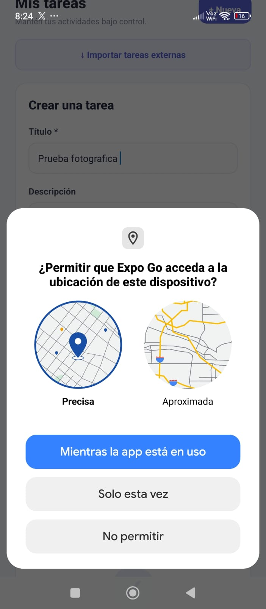

### Evidencia 05. Captura y asociación de fotografías

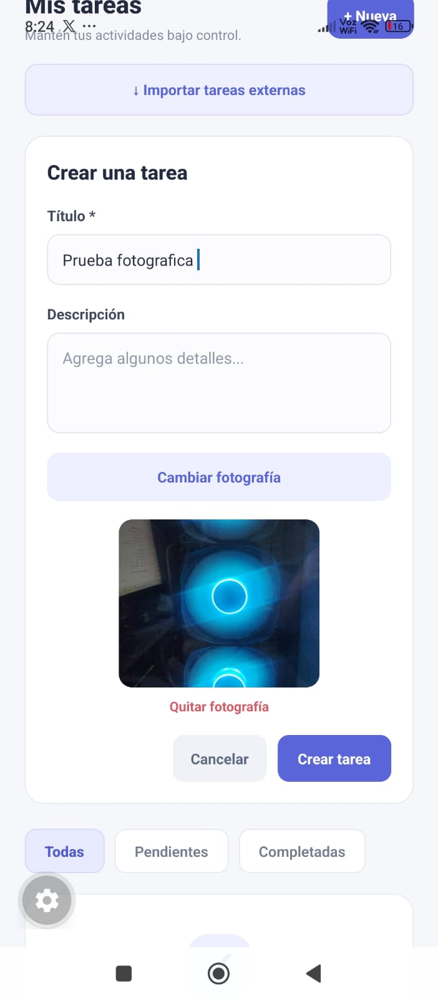

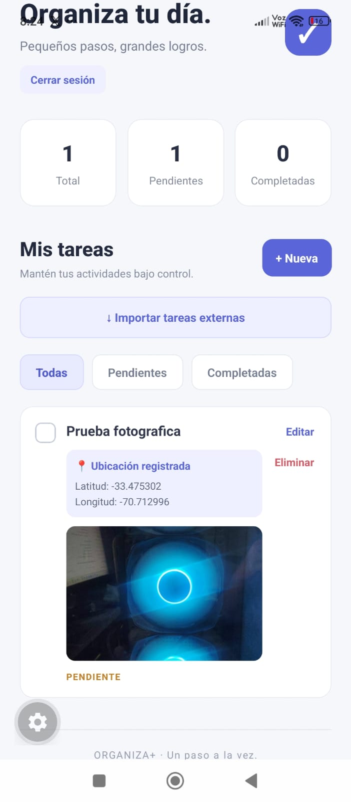

### Evidencia 06. Registro de ubicación GPS

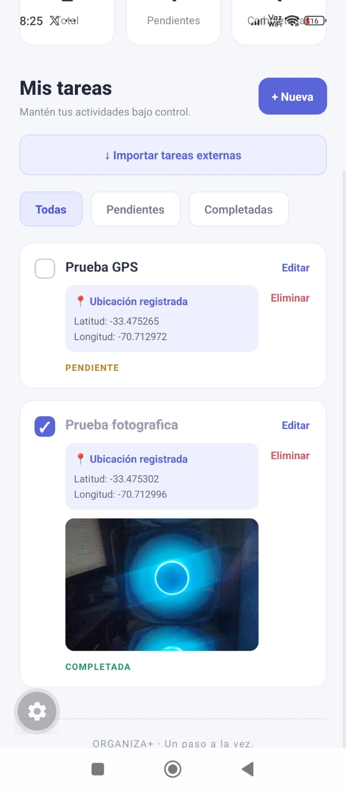

### Evidencia 07. Gestión de tareas

Las siguientes capturas muestran las operaciones de gestión de tareas implementadas en la aplicación.

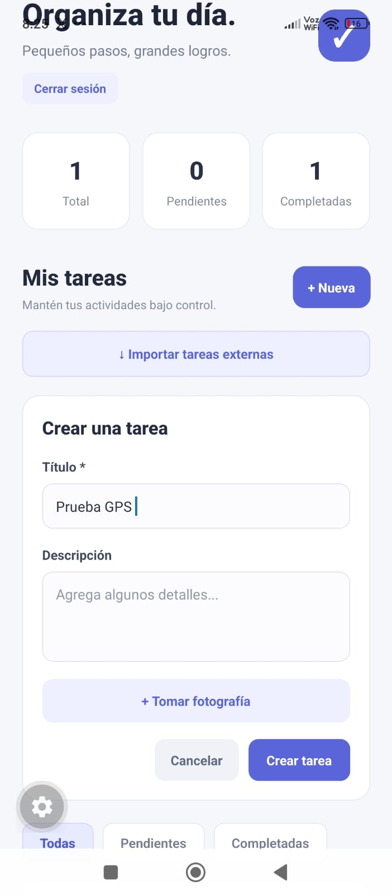

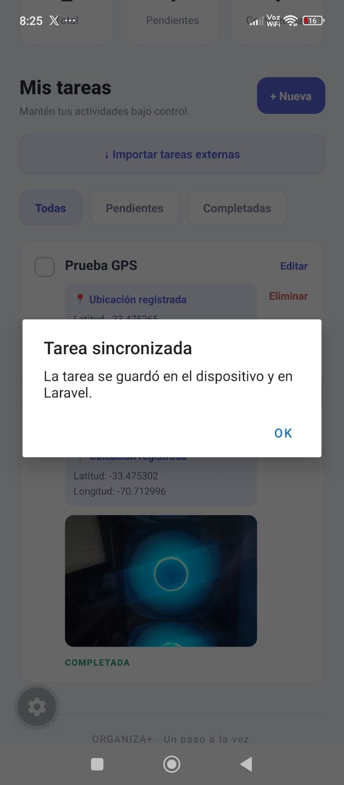

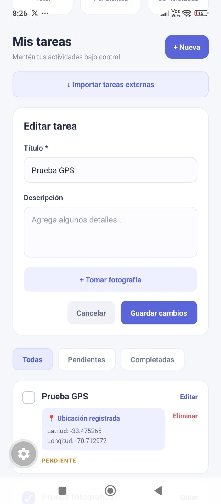

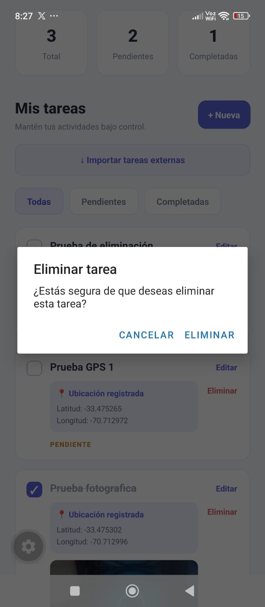

### Evidencia 08. Funcionamiento sin conexión y sincronización

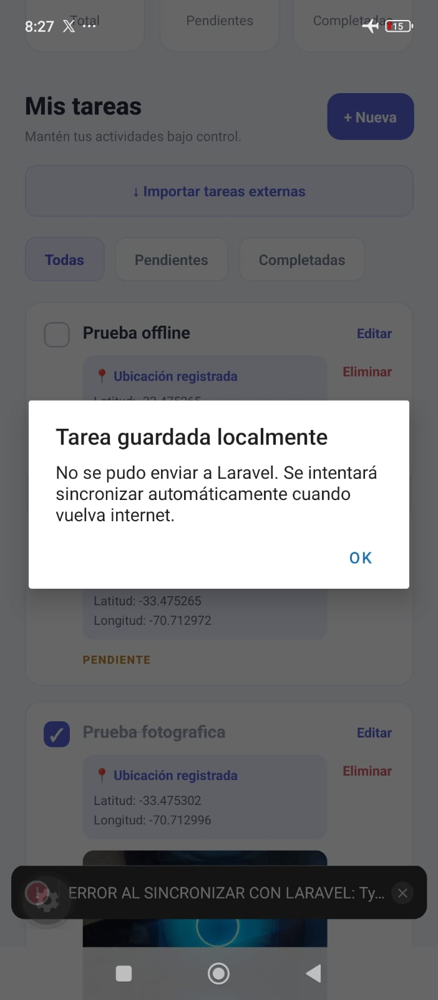

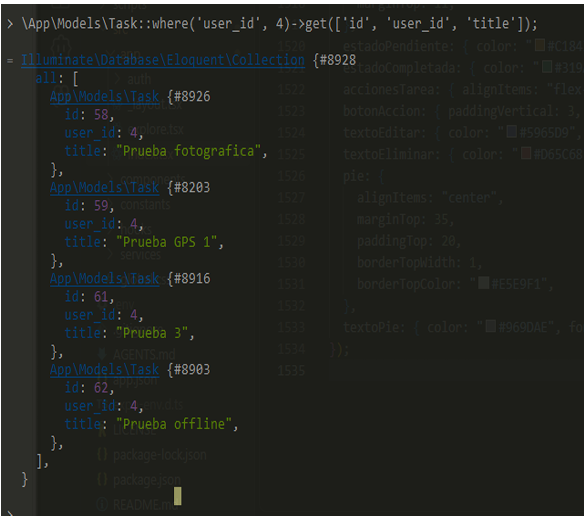

### Evidencia 09. Importación de tareas

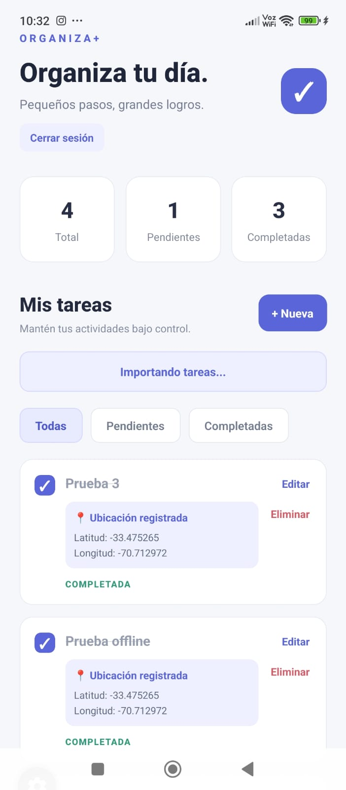

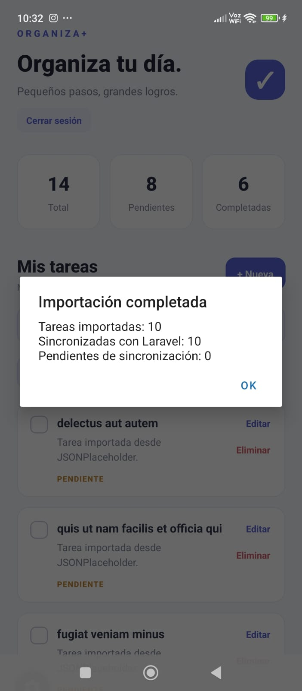

### Evidencia 10. Prevención de registros duplicados

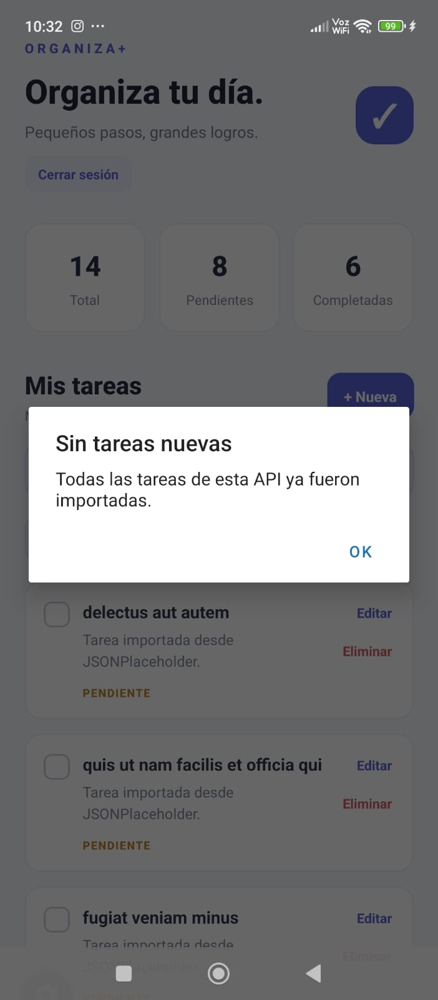

### Evidencia 11. Pruebas automatizadas con Jest

Se ejecutaron tres suites de pruebas, con nueve pruebas aprobadas y ninguna fallida.

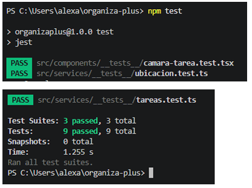

### Evidencia 12. Pruebas de la API REST mediante Postman

**12.1. Acceso sin autenticación**

Se comprueba que una solicitud sin token recibe una respuesta HTTP 401.

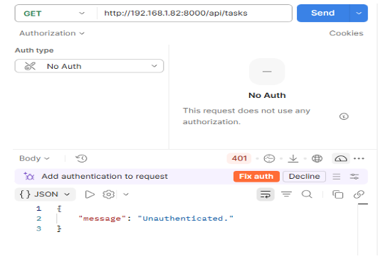

**12.2. Acceso con token válido**

Se comprueba el acceso a la API utilizando un token de autenticación válido.

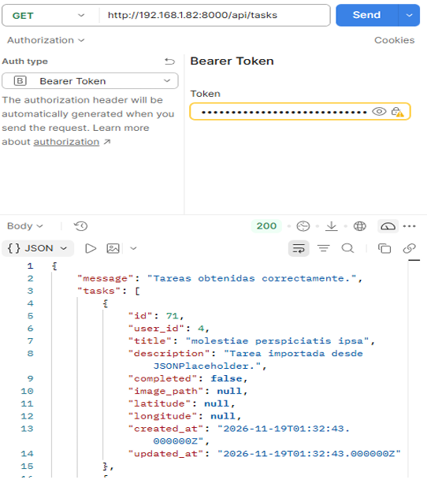

**12.3. Cierre de sesión mediante la API**

Se comprueba el cierre de sesión mediante una solicitud a la API.

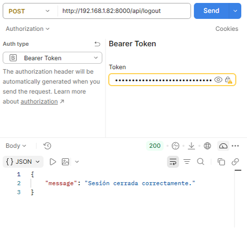

### Evidencia 13. Registros de tareas almacenados en Laravel

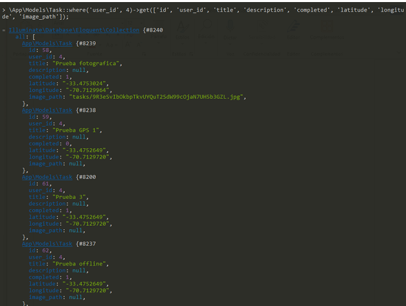

## 11. Video de demostración

En esta sección se incorporará el enlace al video de demostración del proyecto.

**Enlace al video:** Pendiente de incorporar.

## 12. Uso de herramientas de inteligencia artificial

Durante el desarrollo se utilizaron herramientas de inteligencia artificial como apoyo para resolver dudas, comprender conceptos de programación, revisar código y orientar la implementación de algunas funcionalidades.

Las funcionalidades se fueron probando durante el desarrollo para verificar su comportamiento y realizar los ajustes necesarios.

## 13. Conclusión

El desarrollo de Organiza+ permitió aplicar conocimientos de programación móvil mediante React Native, Expo y TypeScript, incorporando funcionalidades de gestión de tareas y utilización de los recursos internos del dispositivo.

La integración de la cámara y el GPS permite complementar las tareas con fotografías y datos de ubicación. Asimismo, el almacenamiento local y la sincronización con un servidor Laravel permiten trabajar con la información incluso cuando no existe conexión a internet.

Las pruebas realizadas permitieron comprobar el funcionamiento de las principales características de la aplicación, incluyendo el acceso a los periféricos, la gestión de tareas, la autenticación y la sincronización de información.

## 14. Repositorio

**Código fuente de Organiza+:**

https://github.com/alexandran-debug/OrganizaPlus
